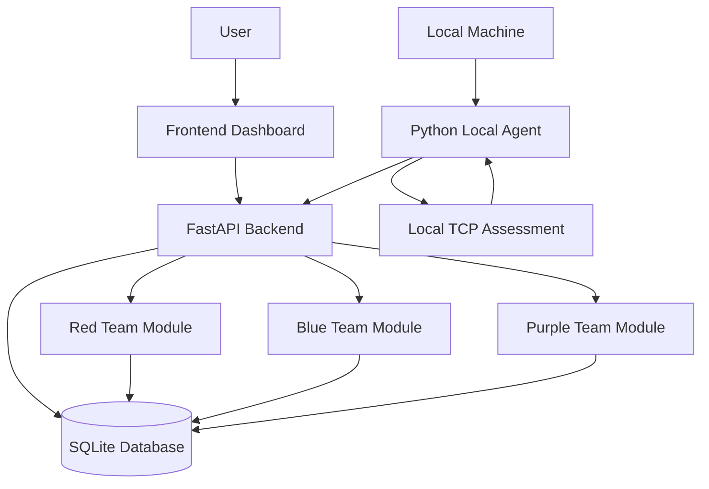

# PurpleShield
## Security Validation and Purple Team Assessment Platform

**Assess. Detect. Validate.**

PurpleShield is a cybersecurity platform that integrates Red Team assessment, Blue Team detection, and Purple Team validation into a unified web-based environment.

The platform enables users to perform controlled local network assessments, process security events, identify potential findings, manage incidents, and validate security findings through retesting.

It also includes a Python-based Local Agent that performs local TCP assessments and sends results to the centralized backend.

---

## Live Project

### Main Application

[Open Live Application](https://purpleshield-1.onrender.com)

### Backend Technical Endpoints

- [Backend Health Check](https://purpleshield.onrender.com/api/health)
- [API Documentation (Swagger)](https://purpleshield.onrender.com/docs)

---

## Table of Contents

1. Project Overview
2. Problem Statement
3. Project Objectives
4. Key Features
5. Red, Blue and Purple Team Modules
6. Local Agent
7. System Architecture
8. Project Structure
9. Technology Stack
10. Application Workflow
11. API Overview
12. Installation and Setup
13. Deployment
14. Security Features
15. Testing and Validation
16. Current Limitations
17. Future Enhancements
18. Disclaimer

---

## 1. Project Overview

PurpleShield is designed to demonstrate how Red Team, Blue Team, and Purple Team activities can work together within a single cybersecurity platform.

It provides functionality for localhost TCP port assessment, security event processing, detection generation, incident management, and security validation.

The platform also includes a Python-based Local Agent that performs local TCP assessments and submits the results to the backend.

## 2. Problem Statement

Red Team assessment, Blue Team monitoring, and Purple Team validation are often performed using separate tools and workflows.

This can make it difficult to connect security findings with detection activities and validation results.

PurpleShield addresses this challenge by providing a unified environment where users can assess local services, process security events, review findings, and perform validation.

## 3. Project Objectives

- Develop an integrated security assessment platform.
- Perform controlled localhost TCP port checks.
- Process security events and generate detections.
- Maintain security findings and incidents.
- Allow analysts to retest selected findings.
- Record PASS/FAIL validation results.
- Integrate a Local Agent with the backend.
- Provide a centralized dashboard for security activities.

## 4. Key Features

### Red Team Assessment

- Localhost-only TCP port assessment.
- Identification of reachable ports.
- Security finding creation and management.
- Assessment history tracking.

### Blue Team Detection

- Security event ingestion.
- Rule-based event analysis.
- Detection generation.
- Incident creation and management.

### Purple Team Validation

- Retesting of selected security findings.
- PASS/FAIL validation results.
- Validation history.
- Synthetic security scenario validation.

### Local Agent

- Python-based local assessment agent.
- TCP port checking on the local machine.
- Token-based communication with the backend.
- Submission of scan results to the platform.

### Dashboard

- Security findings overview.
- Detection and incident information.
- Validation results.
- Local Agent assessment analytics.
- Activity and audit information.

### Authentication and Authorization

- User authentication.
- Password hashing.
- Role-based access control.
- Audit logging.

---

## 5. Red, Blue and Purple Team Modules

| Module | Description |
|---|---|
| Red Team | Performs localhost TCP connectivity assessments and records findings. |
| Blue Team | Processes security events, applies detection rules, and generates incidents. |
| Purple Team | Retests findings and records validation outcomes. |

### Red Team

The Red Team module performs TCP connection checks against permitted loopback targets.

It identifies whether selected ports are reachable and records the assessment results as security findings.

### Blue Team

The Blue Team module processes incoming security events and evaluates them using implemented detection rules.

It generates detections and incidents to help analysts review suspicious activities.

### Purple Team

The Purple Team module allows analysts to select existing findings and perform retesting.

The result is recorded as PASS or FAIL, helping determine whether a previously identified finding can still be reproduced.

---

## 6. Local Agent

PurpleShield includes a Python-based Local Agent that connects the user's local machine with the deployed backend.

The agent performs TCP port checks on localhost and submits assessment results to the backend using an agent token.

**Example Assessment:**

| Parameter | Result |
|---|---|
| Device | DESKTOP-4FKQOUV |
| Target | 127.0.0.1 |
| Ports Checked | 22, 80, 5000, 8000 |
| Open Ports | 5000 |
| Filtered Ports | 22, 80, 8000 |
| Results Submitted | 4 |

The Local Agent must be running on the machine being assessed. A cloud-hosted backend cannot independently scan a user's local computer.

---

## 7. System Architecture



### Architecture Components

- **Frontend:** Provides the user interface and dashboard.
- **Backend:** Handles API requests and application logic.
- **Database:** Stores users, events, findings, detections, incidents, and validation records.
- **Local Agent:** Performs local TCP assessments and communicates with the backend.
- **Red Team:** Performs local security assessments.
- **Blue Team:** Processes events and generates detections.
- **Purple Team:** Performs security validation and retesting.

---

## 8. Project Structure

```text
PurpleShield-main/
└── PurpleShield_MVP/
    └── purpleshield/
        |
        ├── README.md
        |
        ├── backend/
        |   |
        |   ├── app/
        |   |   └── main.py
        |   |
        |   ├── agent.py
        |   ├── connect_agent.py
        |   ├── requirements.txt
        |   └── requirements-test.txt
        |
        ├── frontend/
        |   |
        |   ├── index.html
        |   ├── app.js
        |   ├── auth-extras-v2.js
        |   └── style.css
        |
        └── docs/
            └── architecture.md
```

### Important Files and Their Responsibilities

| File | Purpose |
|---|---|
| `backend/app/main.py` | Main FastAPI backend, API routes, authentication, database, and application logic. |
| `backend/agent.py` | Performs localhost TCP checks and submits assessment results. |
| `backend/connect_agent.py` | Connects the Local Agent and requests an agent token. |
| `backend/requirements.txt` | Backend dependencies. |
| `backend/requirements-test.txt` | Additional testing dependencies. |
| `frontend/index.html` | Main frontend structure. |
| `frontend/app.js` | Frontend functionality and API communication. |
| `frontend/auth-extras-v2.js` | Additional authentication-related frontend functionality. |
| `frontend/style.css` | Frontend styling. |
| `docs/architecture.md` | Project architecture documentation. |

---

## 9. Technology Stack

| Category | Technology |
|---|---|
| Programming Language | Python |
| Backend Framework | FastAPI |
| Frontend | HTML, CSS, JavaScript |
| Database | SQLite |
| API Server | Uvicorn |
| Data Validation | Pydantic |
| Local Agent | Python |
| Version Control | Git and GitHub |
| Deployment | Render |

---

## 10. Application Workflow

1. The user accesses the PurpleShield frontend.
2. The user authenticates through the backend.
3. The Red Team module performs localhost TCP assessments.
4. Assessment findings are stored in the database.
5. The Blue Team module processes security events.
6. Detection rules generate detections and incidents.
7. The Purple Team module retests selected findings.
8. Validation outcomes are stored for review.
9. The Local Agent can independently perform local assessments and submit results to the backend.
10. The dashboard displays the available security information.

---

## 11. API Overview

PurpleShield uses REST APIs through its FastAPI backend.

Some of the implemented API endpoints include:

| Method | Endpoint | Purpose |
|---|---|---|
| GET | `/api/health` | Backend health check |
| POST | `/api/auth/login` | User authentication |
| POST | `/api/auth/logout` | User logout |
| GET | `/api/me` | Current user information |
| GET | `/api/dashboard` | Dashboard data |
| POST | `/api/blue/events` | Security event ingestion |
| GET | `/api/blue/findings` | Retrieve findings |
| GET | `/api/blue/detections` | Retrieve detections |
| GET | `/api/blue/incidents` | Retrieve incidents |
| POST | `/api/red/assess-local` | Local TCP assessment |
| GET | `/api/red/findings` | Retrieve Red Team findings |
| POST | `/api/purple/validate-finding` | Validate a selected finding |
| GET | `/api/purple/validations` | Retrieve validation history |
| POST | `/api/agent/connect` | Connect Local Agent |
| POST | `/api/agent/results` | Submit Local Agent results |
| GET | `/api/audit` | Retrieve audit records |

For complete API details, refer to the Swagger documentation linked in the Live Project section.

---

## 12. Installation and Setup

### Prerequisites

- Python 3.10 or later
- Git
- Visual Studio Code
- Windows PowerShell or terminal
- Web browser

### Step 1: Clone the Repository

```bash
git clone YOUR_GITHUB_REPOSITORY_URL
```

```bash
cd YOUR_REPOSITORY_FOLDER
```

### Step 2: Navigate to Backend

```powershell
cd backend
```

### Step 3: Create a Virtual Environment

```powershell
py -m venv .venv
```

### Step 4: Activate Virtual Environment

```powershell
.\.venv\Scripts\Activate.ps1
```

### Step 5: Install Dependencies

```powershell
py -m pip install -r requirements.txt
```

### Step 6: Run the Backend

```powershell
py -m uvicorn app.main:app --reload
```

### Step 7: Run the Frontend

Open another terminal from the project root:

```powershell
py -m http.server 5500 --directory frontend
```

Open the frontend in your browser using the local development server address.

Check the API base configuration in `frontend/app.js` to ensure the frontend points to the backend you intend to use.

### Step 8: Run the Local Agent

Open a separate terminal inside the backend directory.

Connect the agent:

```powershell
py connect_agent.py
```

Run the agent:

```powershell
py agent.py
```

To specify ports:

```powershell
py agent.py --ports 22,80,443,5000,8000
```

The agent requires user consent and an agent token before submitting assessment results.

---

## 13. Deployment

PurpleShield is deployed using Render with separate frontend and backend services.

### Frontend Service

- Hosts the application interface.
- Provides the main dashboard.
- Communicates with the backend through API requests.

### Backend Service

- Hosts the FastAPI application.
- Handles authentication and API operations.
- Processes security assessments and events.
- Stores application information in SQLite.
- Receives Local Agent results.

---

## 14. Security Features

- Loopback-only TCP assessment restrictions.
- Password hashing using PBKDF2-HMAC-SHA256 with per-user salts.
- Bearer-session authentication.
- Role-based access checks.
- Separate Local Agent tokens.
- Audit logging for relevant operations.
- User consent before Local Agent assessments.

**Security Note:** The current application includes a seeded demo administrator credential in its initial database setup. Change or remove demo credentials before using the application beyond a controlled demonstration. Never commit real credentials or secret keys to GitHub.

---

## 15. Testing and Validation

Development verification has included:

- Backend health endpoint checks.
- Authentication API checks.
- Python syntax compilation.
- Local Agent TCP assessment.
- Submission of assessment results to the backend.
- Dashboard analytics verification.
- Finding retesting and validation workflows.

Automated test coverage is not claimed for the supplied project snapshot because a test suite was not included in the reviewed ZIP.

---

## 16. Current Limitations

- TCP assessments are restricted to loopback targets.
- Service names inferred from port numbers are probable hints, not active service fingerprinting.
- Detection rules are basic and rule-based.
- The Local Agent must be running locally to assess the user's computer.
- The cloud backend cannot independently access the user's local machine.
- Some advanced incident and finding relationship operations are API-based.
- Automated Local Agent startup and fully dashboard-triggered local scanning are future improvements.

---

## 17. Future Enhancements

- Automated Local Agent startup.
- Improved dashboard-triggered local assessment workflow.
- Advanced service fingerprinting.
- Additional security detection rules.
- Enhanced incident investigation.
- Improved security analytics and reporting.
- Exportable assessment reports.
- Expanded automated testing.
- Improved authentication and session management.

---

## 18. Disclaimer

PurpleShield is developed for educational, demonstration, and authorized local security testing purposes.

Use the platform only on systems you own or have explicit permission to assess. The project is not intended to replace enterprise-grade SIEM, vulnerability management, or professional penetration-testing solutions.

---

## Project Information

**Project Name:** PurpleShield

**Project Domain:** Cybersecurity

**Project Type:** Security Validation and Purple Team Assessment Platform

**Backend:** Python, FastAPI

**Frontend:** HTML, CSS, JavaScript

**Database:** SQLite

**Deployment:** Render

**Version Control:** GitHub

---

**PurpleShield — Assess. Detect. Validate.**
