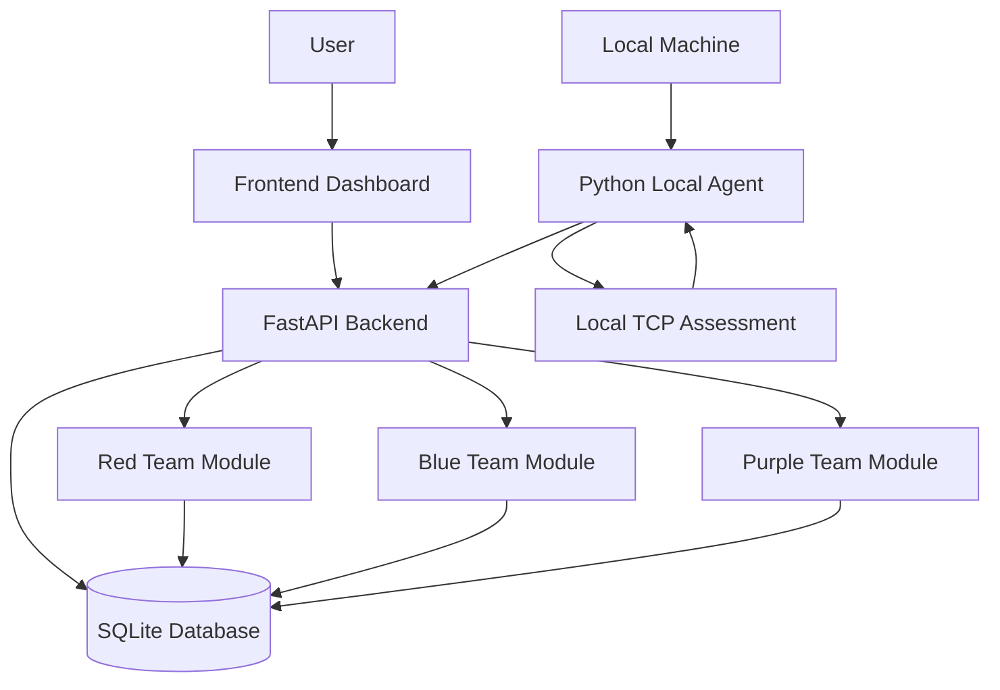

# PurpleShield
## Security Validation and Purple Team Assessment Platform

**Assess. Detect. Validate.**

PurpleShield is a cybersecurity platform that integrates Red Team assessment, Blue Team detection, and Purple Team validation into a unified web-based environment.

The platform enables users to perform controlled local network assessments, process security events, identify potential findings, manage incidents, and validate security findings through retesting.

It also includes a Python-based Local Agent that performs local TCP assessments and sends results to the centralized backend.

---

## Live Project

### Main Application

[Open Live Application](https://purpleshield-1.onrender.com)

### Backend Technical Endpoints

- [Backend Health Check](https://purpleshield.onrender.com/api/health)
- [API Documentation (Swagger)](https://purpleshield.onrender.com/docs)

---

## Table of Contents

1. Project Overview
2. Problem Statement
3. Project Objectives
4. Key Features
5. Red, Blue and Purple Team Modules
6. Local Agent
7. System Architecture
8. Project Structure
9. Technology Stack
10. Application Workflow
11. API Overview
12. Installation and Setup
13. Deployment
14. Security Features
15. Testing and Validation
16. Current Limitations
17. Future Enhancements
18. Disclaimer

---

## 1. Project Overview

PurpleShield is designed to demonstrate how Red Team, Blue Team, and Purple Team activities can work together within a single cybersecurity platform.

It provides functionality for localhost TCP port assessment, security event processing, detection generation, incident management, and security validation.

The platform also includes a Python-based Local Agent that performs local TCP assessments and submits the results to the backend.

## 2. Problem Statement

Red Team assessment, Blue Team monitoring, and Purple Team validation are often performed using separate tools and workflows.

This can make it difficult to connect security findings with detection activities and validation results.

PurpleShield addresses this challenge by providing a unified environment where users can assess local services, process security events, review findings, and perform validation.

## 3. Project Objectives

- Develop an integrated security assessment platform.
- Perform controlled localhost TCP port checks.
- Process security events and generate detections.
- Maintain security findings and incidents.
- Allow analysts to retest selected findings.
- Record PASS/FAIL validation results.
- Integrate a Local Agent with the backend.
- Provide a centralized dashboard for security activities.

## 4. Key Features

### Red Team Assessment

- Localhost-only TCP port assessment.
- Identification of reachable ports.
- Security finding creation and management.
- Assessment history tracking.

### Blue Team Detection

- Security event ingestion.
- Rule-based event analysis.
- Detection generation.
- Incident creation and management.

### Purple Team Validation

- Retesting of selected security findings.
- PASS/FAIL validation results.
- Validation history.
- Synthetic security scenario validation.

### Local Agent

- Python-based local assessment agent.
- TCP port checking on the local machine.
- Token-based communication with the backend.
- Submission of scan results to the platform.

### Dashboard

- Security findings overview.
- Detection and incident information.
- Validation results.
- Local Agent assessment analytics.
- Activity and audit information.

### Authentication and Authorization

- User authentication.
- Password hashing.
- Role-based access control.
- Audit logging.

---

## 5. Red, Blue and Purple Team Modules

| Module | Description |
|---|---|
| Red Team | Performs localhost TCP connectivity assessments and records findings. |
| Blue Team | Processes security events, applies detection rules, and generates incidents. |
| Purple Team | Retests findings and records validation outcomes. |

### Red Team

The Red Team module performs TCP connection checks against permitted loopback targets.

It identifies whether selected ports are reachable and records the assessment results as security findings.

### Blue Team

The Blue Team module processes incoming security events and evaluates them using implemented detection rules.

It generates detections and incidents to help analysts review suspicious activities.

### Purple Team

The Purple Team module allows analysts to select existing findings and perform retesting.

The result is recorded as PASS or FAIL, helping determine whether a previously identified finding can still be reproduced.

---

## 6. Local Agent

PurpleShield includes a Python-based Local Agent that connects the user's local machine with the deployed backend.

The agent performs TCP port checks on localhost and submits assessment results to the backend using an agent token.

**Example Assessment:**

| Parameter | Result |
|---|---|
| Device | DESKTOP-4FKQOUV |
| Target | 127.0.0.1 |
| Ports Checked | 22, 80, 5000, 8000 |
| Open Ports | 5000 |
| Filtered Ports | 22, 80, 8000 |
| Results Submitted | 4 |

The Local Agent must be running on the machine being assessed. A cloud-hosted backend cannot independently scan a user's local computer.

---

## 7. System Architecture



### Architecture Components

- **Frontend:** Provides the user interface and dashboard.
- **Backend:** Handles API requests and application logic.
- **Database:** Stores users, events, findings, detections, incidents, and validation records.
- **Local Agent:** Performs local TCP assessments and communicates with the backend.
- **Red Team:** Performs local security assessments.
- **Blue Team:** Processes events and generates detections.
- **Purple Team:** Performs security validation and retesting.

---

## 8. Project Structure

```text
PurpleShield-main/
└── PurpleShield_MVP/
    └── purpleshield/
        |
        ├── README
