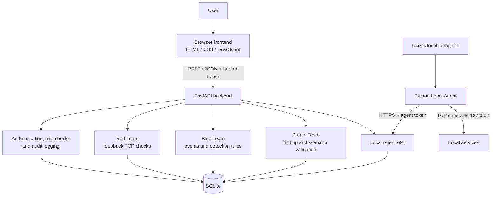

 PurpleShield
Local-First Security Validation & Purple Team Assessment Platform
Assess. Detect. Validate.

PurpleShield is an educational cybersecurity MVP that brings basic Red Team assessment, Blue Team event detection, and Purple Team validation into one web-based workspace. It focuses on safe, localhost-only TCP connectivity checks, explainable event-detection rules, incident and finding management, and validation workflows.

  <a href="https://purpleshield-1.onrender.com"><strong> Live Application</strong></a>
  &nbsp; · &nbsp;
  <a href="https://purpleshield.onrender.com/api/health">Backend Health</a>
  &nbsp; · &nbsp;
  <a href="https://purpleshield.onrender.com/docs">API Docs</a>

Deployment note: The frontend and backend are separate Render services. Use the frontend link as the application entry point. The backend root URL is not a homepage; use the health and API documentation endpoints above. Confirm the endpoints are reachable before sharing this README publicly.

Contents
- Overview
- Problem and objectives
- Features
- Team modules
- Local Agent
- Architecture
- Repository structure
- Technology stack
- Application workflow
- API reference
- Run locally
- Local Agent setup
- Demo walkthrough
- Database and persistence
- Security boundaries
- Testing
- Known limitations
- Roadmap
- Disclaimer
   Overview
PurpleShield connects three complementary security activities:
- Red Team: checks TCP connectivity to selected ports on the local machine and records findings.
- Blue Team: ingests security events, applies simple transparent detection rules, and tracks detections and incidents.
- Purple Team: retests Red Team findings and validates a synthetic repeated-login scenario.
A separate Python Local Agent can assess localhost ports on a user's own computer and send the results to the hosted backend. A shared dashboard presents the resulting operational data.

This is a local-first educational MVP, not a production SIEM, vulnerability scanner, or automated penetration-testing platform.
 Problem and objectives
Security assessment, monitoring, and validation are often demonstrated as separate activities. PurpleShield provides a small integrated environment to demonstrate how a finding can move from assessment to defensive review and retesting.

Project objectives:
- Demonstrate a controlled, localhost-only TCP assessment workflow.
- Store findings and assessment history.
- Ingest synthetic security events and evaluate explainable rules.
- Create and review detections and incidents.
- Retest findings and preserve validation history.
- Demonstrate a local agent-to-backend reporting workflow.
- Record relevant user actions in an audit log.
 Features
Area	Implemented capability
Authentication	Sign-in, sign-out, password hashing, expiring in-memory bearer sessions
Access control	Role checks on backend operations and administrator user-management APIs
Red Team	Loopback-only TCP connect checks, assessment history, finding deduplication by target and port
Blue Team	Synthetic event ingestion, transparent detection rules, detections and incidents
Incident management	Incident status updates and links to detections/findings
Purple Team	Finding retests and synthetic repeated-login validation
Local Agent	Localhost port checks, token-based result submission, result history and token revocation
Dashboard	Common workspace for operational metrics, activity, findings, incidents and validations
Audit	Persistent audit records for relevant actions

Detection scenarios
The current backend includes simple, explainable rules for:
- Repeated failed login events.
- File-integrity-change events.
These are rule-based demonstrations, not machine-learning detections.
   Red, Blue and Purple Team modules
   Red Team — Local assessment
The POST /api/red/assess-local endpoint accepts loopback IP addresses (127.0.0.1 or ::1) and performs basic TCP connection checks. Findings are associated with target IP and port. Repeated assessments for the same target/port are deduplicated.

Common port numbers may be assigned probable service hints. These hints are inferred from port numbers; PurpleShield does not perform protocol-level service fingerprinting.
Blue Team — Event detection and incident review
The Blue Team workflow accepts synthetic security events, stores them, evaluates the implemented rules, and creates detections and incidents. Analysts can review findings and incidents and update supported statuses or relationships.
 Purple Team — Validation
The Purple Team workflow can:
- Retest an existing Red Team finding using a localhost TCP check.
- Store a PASS/FAIL validation result linked to the finding.
- Run the synthetic repeated-login validation scenario.
- Associate the synthetic scenario with MITRE ATT&CK T1110 – Brute Force.
Finding retests record validation history; they do not automatically change the finding's status.
   Local Agent
The Local Agent is a separate Python script running on the user's own computer. It checks selected TCP ports on 127.0.0.1 and sends the results to the PurpleShield backend using an agent token.

Files:
- backend/connect_agent.py — signs in and requests an agent token.
- backend/agent.py — asks for scan consent, checks the selected localhost ports, and submits results.
The agent's default port list is 80,22,5000,8000. A user can provide another comma-separated list with --ports.

Important: the Local Agent must be running on the computer being assessed. A cloud-hosted backend cannot independently access a user's laptop or its localhost ports.
Architecture

The frontend calls the FastAPI backend over REST/JSON. The backend applies authentication and role checks, executes module workflows, and persists application records in SQLite. The Local Agent communicates with the agent API over HTTPS.
 Repository structure
The uploaded project contains the following files:
PurpleShield-main/
└── PurpleShield_MVP/
    └── purpleshield/
        ├── README.md
        ├── backend/
        │   ├── agent.py
        │   ├── app/
        │   │   └── main.py
        │   ├── connect_agent.py
        │   ├── requirements.txt
        │   └── requirements-test.txt
        ├── docs/
        │   └── architecture.md
        └── frontend/
            ├── app.js
            ├── auth-extras-v2.js
            ├── index.html
            └── style.css
Path	Responsibility
backend/app/main.py	FastAPI application, API routes, authentication/authorization, database setup and module logic
backend/agent.py	Localhost TCP scanner and authenticated result submission
backend/connect_agent.py	Login flow and Local Agent token connection
backend/requirements.txt	Runtime Python dependencies
backend/requirements-test.txt	Additional test dependency
frontend/index.html	Main application markup and page layout
frontend/app.js	Frontend interactions and API communication
frontend/auth-extras-v2.js	Additional authentication-related frontend behavior
frontend/style.css	Application styling and responsive layout
docs/architecture.md	Architecture overview

The ZIP provided for review does not include a backend/tests/ directory, deployment configuration files, or screenshots. The README therefore does not claim those files are present.
 Technology stack
Layer	Technology
Language	Python
Backend framework	FastAPI
ASGI server	Uvicorn
Request/data validation	Pydantic
Frontend	HTML, CSS, vanilla JavaScript
Database	SQLite
Local Agent	Python socket and HTTPS standard-library modules
API interface	REST / JSON; FastAPI Swagger UI
Version control	Git / GitHub
Hosting	Render

Runtime dependencies listed in backend/requirements.txt:
- fastapi==0.115.12
- uvicorn[standard]==0.34.2
- pydantic==2.11.4
   Application workflow
1. A user opens the PurpleShield frontend and signs in.
2. The frontend sends authenticated REST requests to the FastAPI backend.
3. Red Team performs an allowed localhost TCP assessment and records findings.
4. Blue Team ingests security events and evaluates the configured detection rules.
5. Detections and incidents are stored and displayed in the workspace.
6. Purple Team retests a selected finding or runs the synthetic validation scenario.
7. The Local Agent can independently check localhost ports and submit the results to the agent API.
8. The dashboard presents stored assessment, detection, incident, agent and validation information.
 API reference
The following routes are defined in backend/app/main.py. All paths are relative to the backend origin. Protected routes require the authentication mechanism described by the API; agent result submission uses an agent token.
Method	Endpoint	Purpose
GET	/api/health	Backend health response
POST	/api/auth/login	Authenticate and create a session
POST	/api/auth/logout	End the current session
GET	/api/me	Return current user information
GET	/api/dashboard	Dashboard data
POST	/api/demo/seed	Load demo security events
POST	/api/blue/events	Ingest security events
GET	/api/blue/events	List security events
GET	/api/blue/findings	List findings for Blue Team review
GET	/api/blue/detections	List detections
GET	/api/blue/incidents	List incidents
PUT	/api/blue/incidents/{incident_id}/links	Update incident relationships
PATCH	/api/blue/incidents/{incident_id}	Update incident fields/status
POST	/api/red/assess-local	Assess allowed localhost TCP ports
GET	/api/red/assessment-history	Retrieve Red Team assessment history
GET	/api/red/findings	List Red Team findings
PATCH	/api/red/findings/{finding_id}	Update a Red Team finding
PATCH	/api/blue/findings/{finding_id}	Update a finding through Blue Team
POST	/api/purple/validate-finding	Retest a selected finding
POST	/api/purple/validate-demo	Run synthetic scenario validation
GET	/api/purple/validations	Retrieve validation history
GET	/api/admin/users	List users (admin operation)
POST	/api/admin/users	Create a user (admin operation)
PATCH	/api/admin/users/{user_id}	Update a user (admin operation)
GET	/api/audit	Retrieve audit records
POST	/api/agent/connect	Create/connect a Local Agent
POST	/api/agent/results	Submit Local Agent scan results
GET	/api/agent/results	Retrieve Local Agent results
POST	/api/agent/revoke	Revoke an agent token

For request schemas, response examples, and interactive exploration, use the deployed Swagger UI or run the backend locally at http://127.0.0.1:8000/docs.
 Run locally
Prerequisites
- Windows 10/11 (commands below use PowerShell)
- Python 3.10 or later
- Git (if cloning from GitHub)
- A modern web browser
1. Open the project folder
Extract the ZIP and open the purpleshield directory in VS Code. In PowerShell:
cd path\to\PurpleShield-main\PurpleShield_MVP\purpleshield
2. Create and activate a virtual environment
cd backend
py -m venv .venv
.\.venv\Scripts\Activate.ps1
If PowerShell blocks script activation, use Command Prompt and run:
.venv\Scripts\activate.bat
3. Install backend dependencies
py -m pip install -r requirements.txt
4. Start the backend
py -m uvicorn app.main:app --reload
The backend should be available at:
- API base: http://127.0.0.1:8000
- Health: http://127.0.0.1:8000/api/health
- Swagger UI: http://127.0.0.1:8000/docs
5. Start the frontend
Open a second PowerShell terminal from the purpleshield project root and run:
py -m http.server 5500 --directory frontend
Then open http://127.0.0.1:5500 in your browser.
The frontend's API configuration must point to the backend you are running. Check the API base configuration in frontend/app.js before local use if requests are being sent to the hosted service.

Local Agent setup
Keep the backend running. Open another terminal in the backend directory.
1. Connect the agent and obtain a token
py connect_agent.py
Enter your PurpleShield username and password when prompted. The script requests an agent token. Treat this token as a secret.
2. Run the Local Agent
py agent.py
The script asks for explicit scan consent, then prompts for the agent token. It scans the default ports 80,22,5000,8000.

To specify ports:
py agent.py --ports 22,80,443,5000,8000
Only your own machine's localhost ports are assessed. Do not share the agent token or commit it to source control.
 Suggested demo walkthrough
1. Sign in to the application.
2. Open Red Team and assess selected localhost ports.
3. Open Blue Team / Findings to review the generated finding and supported status controls.
4. Open Purple Team, select a finding, and retest it.
5. Review the PASS/FAIL result in validation history.
6. Use the demo-event action to load synthetic events.
7. Review the resulting detections and incidents in Blue Team.
8. Run the synthetic repeated-login validation scenario in Purple Team.
9. Connect and run the Local Agent to submit a local port assessment.
    Database and persistence
The backend uses SQLite. The application creates and maintains tables for:
- users
- events
- detections
- incidents
- findings
- validations
- audit_log
- assessment_history
- incident_detections
- incident_findings
- local_agents
- local_agent_scans
The backend also contains startup migration logic for existing databases, including a database backup before schema updates and relationship-table/index updates. The actual database file is created at runtime; it is not included in the uploaded source ZIP.
   Security boundaries
- Red Team assessment is restricted to loopback IP addresses (127.0.0.1 and ::1); non-loopback targets and hostnames are rejected by the assessment endpoint.
- The assessment performs a basic TCP connection check only. It does not exploit services.
- Passwords are stored using PBKDF2-HMAC-SHA256 with per-user salts.
- Authenticated API operations use bearer sessions; sessions are held in process memory, expire after eight hours, and are cleared when the backend process restarts.
- Local Agent results use a separate agent token.
- Role checks and audit logging are implemented in the backend.
Demo credential warning: the current backend seeds a local demo account (admin / Purple@123) when the user table is empty. Change or remove this demo credential before any deployment intended for use beyond a classroom demonstration. Never reuse it for real accounts.
🧪 Testing
The supplied ZIP includes backend/requirements-test.txt, but it does not include a backend/tests/ directory or test files. Therefore, this README does not claim a verified automated test-suite result for the uploaded snapshot.

The project documentation describes a unittest command for a test suite, but the referenced test files were not present in the ZIP reviewed. Add the test directory and run the suite before publishing any test-pass badge or test-coverage claim.

Manual verification can include:
- Health endpoint response.
- Login and authenticated dashboard access.
- Loopback-only assessment behavior.
- Event ingestion and detection generation.
- Finding retest and validation-history recording.
- Local Agent token connection and result submission.
   Known limitations
- This is an educational MVP, not a production SIEM or vulnerability scanner.
- Red Team checks are limited to localhost and basic TCP connection status.
- Port-to-service labels are probable hints, not active service fingerprinting.
- Blue Team rules are simple and transparent; no real ML anomaly detection is implemented.
- The Local Agent must be run on the machine being assessed; the cloud service cannot directly scan a user's laptop.
- Bearer sessions are in-memory and are not production-grade JWT/session management.
- Password reset, automated remediation, network-wide monitoring, exploit validation, and complete role-specific UI navigation are not implemented.
- Some advanced relationship management is exposed through backend APIs and may not have a dedicated UI workflow.
 Roadmap
Potential next steps:
- Expand automated unit and integration test coverage.
- Improve role-specific navigation and authorization UX.
- Add safe lab asset inventory.
- Add evidence and assessment-report export.
- Improve incident investigation and relationship management.
- Evaluate additional detection rules using labelled synthetic events.
- Consider more robust production session and credential-management approaches.
- Improve Local Agent lifecycle and usability while preserving explicit user consent and localhost-only scope.
   Disclaimer
PurpleShield is intended for education, demonstration, and authorized local testing. Use it only on systems you own or are explicitly authorized to assess. Do not remove the loopback restriction or use the project to test external systems without written authorization.
